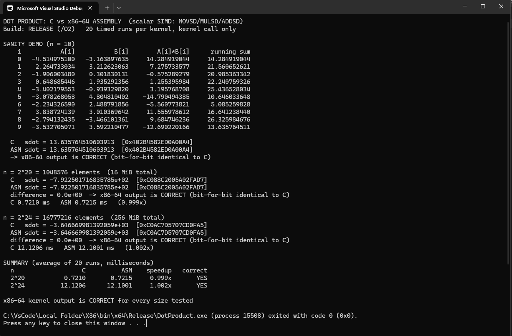
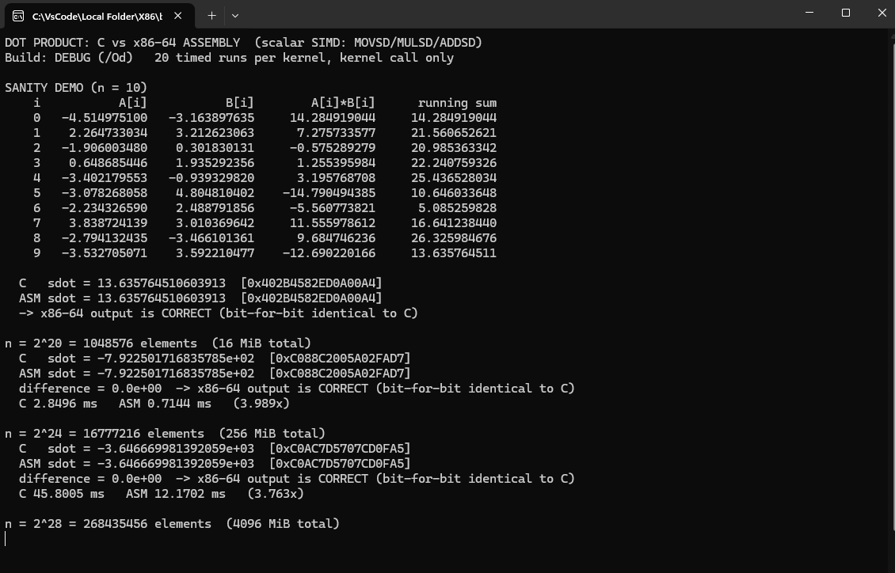

S25D Shao Wei Wang

# Dot Product: C vs. x86-64 Assembly (Scalar SIMD)

Computes `sdot = sum(A[i] * B[i])` over two double-precision vectors, once in C and once in
x86-64 assembly, called from a single C `main` that times both and checks the results match.

Open `DotProduct.sln`, select **x64** (Debug or Release), press **Ctrl+F5**.

## Scalar SIMD

The assembly kernel uses **XMM0** (running sum) and **XMM1** (product), with only the scalar
double-precision instructions **MOVSD**, **MULSD** and **ADDSD**. No packed operations are used.
The inner loop is:

```asm
main_loop:
        movsd   xmm1, QWORD PTR [rdx + rax*8]   ; A[i]
        mulsd   xmm1, QWORD PTR [r8  + rax*8]   ; A[i] * B[i]
        addsd   xmm0, xmm1                      ; sum += A[i] * B[i]
        inc     rax
        cmp     rax, rcx
        jb      main_loop
```

Parameters follow the Microsoft x64 convention: `RCX` = n, `RDX` = A, `R8` = B, `R9` = sdot.

## Correctness

The C kernel is the answer key. The assembly result matched it exactly at the IEEE-754 bit level
in all 10 comparisons (5 sizes × 2 build configurations), with a difference of `0.0`. They match
exactly rather than closely because `/fp:precise` stops the compiler from reordering the sum, so
both kernels add the terms in the same order.

### Program output

Both kernels run and print in the same pass, so each screenshot shows the C result, the x86-64
result, and the check comparing the two.

**Release build**



**Debug build** — same results, and this is where the speedup shows.



## Execution time

Average of 20 timed runs, in milliseconds. Only the kernel call is timed.

| n | Debug C | Debug ASM | Speedup | Release C | Release ASM | Speedup |
|---|---:|---:|---:|---:|---:|---:|
| 2²⁰ | 2.8662 | 0.7178 | **3.99×** | 0.7273 | 0.7395 | 0.98× |
| 2²⁴ | 45.9708 | 12.4961 | **3.68×** | 12.3382 | 12.3671 | 1.00× |
| 2²⁸ | 743.5717 | 216.6033 | **3.43×** | 207.9370 | 206.8095 | 1.01× |
| 2²⁹ | 1484.9164 | 429.8966 | **3.45×** | 461.4637 | 435.2223 | 1.06× |

Tested on an AMD Ryzen 5 5600 (Zen 3, ~4.1 GHz under load, 32 MB L3) with 16 GB DDR4-3200.

## Analysis

In Release both versions run at the same speed. Checking the disassembly, MSVC at `/O2` produces
the same `movsd`, `mulsd` and `addsd` instructions as the assembly kernel. It cannot use packed
instructions because `/fp:precise` does not allow reordering a floating-point sum. So there was
nothing left for the assembly version to improve.

In Debug the assembly is 3.4x to 4x faster, but this is really measuring `/Od`, not assembly. At
`/Od` the compiler keeps `sum` and `i` on the stack and reloads them every iteration, about 20
instructions per element instead of 6. The assembly kernel is unaffected because `ml64` does no
optimisation, so its machine code is the same in both configurations.

The loop is limited by the `addsd` dependency chain, not memory bandwidth. Time per element stays
around 0.7 to 0.8 ns at every size, even though 2²⁰ fits in the 32 MB L3 cache and 2²⁹ is 256
times larger than it. At ~4.1 GHz that is about 3 cycles per element, which matches `addsd`
latency on Zen 3, and only 21.8 GB/s of the available 51.2 GB/s is used. Since there is one
accumulator, each iteration has to wait for the previous addition to finish.

n = 2³⁰ would need 16 GiB of vectors on a 16 GB machine, so the largest size was reduced to 2²⁹
(8 GiB). Its 0.81 ns/element matches the smaller sizes, so it was not paging.
